# Phase 6: Network Design Challenge

Use Claude or another AI assistant. Ask it to help you understand the simulator, explore alternatives, build the ops page, or run experiments. You own the recommendations and the evidence behind them.

**This is an optional extra-credit challenge after Phase 5.** The design brief is intentionally vague. Expect limited guidance on how to solve it. You get the client brief, simulator, starter policy, and public checks. You decide what to change, how to evaluate it, and what evidence supports your recommendation. Work alone or as a team. Alongside the transport design, build a working race ops page that reads simulator results and helps the crew make a decision.

## What we're looking for

AI can generate several plausible policies, charts, or screens in minutes. The work we're evaluating is what you do with those options.

**Good taste.** Decide what the crew actually needs to know. Choose a few useful measurements and make the next action easy to see.

**Sound judgment.** Know what you gain and what you give up. Explain when your design would stop making sense and what evidence would make you change your mind.

**Effective use of AI.** Use it to get oriented and test ideas faster. Double-check its claims against the logs, your calculations, or a fresh run. In your memo, show one suggestion you accepted, changed, or rejected and the evidence behind that decision.

## Extra credit and the final exam

Only the top performers in the class will be eligible to skip the final. Your design, evidence, working race ops page, and live review all count. If you work as a team, each person is also assessed on what they contributed and can explain.

If you complete the challenge and still take the final, you earn extra credit based on the work you submit and explain on your phase grade. A phase grade can exceed 100% when the final course grade is calculated.

## Client brief: Race day replay

Your university's electric race team is testing a new car. The front tires lock up under braking in Turn 4. The crew sends a replay tag, such as “00:14, front tires locked,” so the garage engineer knows where to look. A separate status update can tell the engineer whether the camera is recording. The video shows the driver's steering and what happened before and after the tires locked. The engineer needs that footage to work out why it happened.

In the simulator, a trackside sender uploads the clip. A garage receiver collects the video and the crew's updates. Both types of data travel through one send queue and share a 2 Mb/s wireless link. The garage must receive every byte of the clip within the case's upload time limit. While the clip is uploading, keep crew updates timely and decide what to do with them if the link cuts out.



## Start here: Pick a case

A case is one experiment. It sets the clip size, schedules the crew's updates, and defines any outages. A policy tells the trackside sender how to schedule and queue data and what to do with updates when the connection drops.

Your main task is to change the sender's settings in `policy.json` and defend those changes with evidence. Run the supplied policy first, try changes in a copy with `--policy`, then put your recommendation in `policy.json`. The simulator and cases are provided for your experiments.

For your submission, run both policies on all five public cases. You'll get a separate case during the live review. Other grading checks will stay private.

### 1. Healthy

| Video deliverable | Crew update requirements |
| --- | --- |
| All **20 MB** by **120 s**. | **1 update** in under **1,200 ms**. |

### 2. Busy

| Video deliverable | Crew update requirements |
| --- | --- |
| All **20 MB** by **120 s**. | **3 updates**, each in under **850 ms**. |

### 3. Outage

| Video deliverable | Crew update requirements |
| --- | --- |
| All **20 MB** by **125 s**. | **4 updates total.** The **2 created while connected** must arrive in under **1,200 ms** each. For the **2 created during the outage**, decide what is worth keeping. Expired updates cannot be delivered. |

### 4. Medium

| Video deliverable | Crew update requirements |
| --- | --- |
| All **40 MB** by **200 s**. | **2 updates**, each in under **850 ms**. |

### 5. Large

| Video deliverable | Crew update requirements |
| --- | --- |
| All **60 MB** by **290 s**. | **120 updates**, each in under **850 ms**. |

Update deadlines start when each update is created. An update that arrives exactly at its deadline is stale. Use the log to find the update names, creation times, and link changes.

## Open one log for all five cases

From this repo, run the starter policy on all five cases and save one log:

```bash
python3 -m netlab --all \
  --log runs/public.log
```

Open `runs/public.log` in a text editor. It contains one row per 10 ms step, and each case starts at 0 s. Search for `case=healthy` or another case name. Read a row from left to right:

- Queue shows shared bytes at the start of the step, after link changes and new admissions, and after sending. A partially sent packet stays in the queue count until it finishes sending.
- Video shows bytes added to the queue, bytes sent onto the link, and bytes received by the garage.
- Update events show creation, queue admission, transmission, and delivery or failure. A U number identifies a crew update. Each time it joins the queue it gets a P number for that 200-byte packet.

In the first `healthy` row at 0.000 s, the link is up and no updates are pending. The queue starts empty, rises to 12,000 B as video joins, then drops to 10,000 B after sending 2,500 B (a partly sent chunk still counts in full), while the garage has received 0 B.

An Events field appears on the steps where something happened. Use the log to investigate what the sender and garage saw.

## Read the outage and busy cases

Find `case=outage` in the shared log. Identify the link changes and track the four updates. Explain how the starter handles the updates that appear during the outage. Which outcome would the crew want to change, and under what conditions?

Find `case=busy` and follow one update from creation to its final outcome. Choose what to examine and explain what the log tells you.

Use `--case busy --log runs/busy.log` for a smaller log in the same format. Use `--out` to save the individual JSON results required for your submission.

The shared queue has room for 262,144 bytes of waiting data. Time limits are measured separately.

## Try a change, then run it again

Use the starter runs as a baseline. The settings you can change are listed in the simulator reference below. In your memo, explain the behavior you observed and how you checked an AI-assisted claim.

Copy `policy.json` to `trial.json`. Choose one change, predict what it will improve and what it might cost, then rerun the same case:

```bash
python3 -m netlab \
  --case busy \
  --policy \
  trial.json \
  --out \
  runs/trial.json
```

Compare your policies across all five cases. Put the policy you recommend in `policy.json`, then run:

```bash
python3 -m netlab --all
```

The terminal marks each public case, the video deliverable, and the crew update requirements as **PASS** or **FAIL**. Compare the target shown with the measured outcome and use the log to investigate failures. The command returns exit status 1 if any public case fails. It still saves requested output files so you can analyze a failed trial.

Save the ten results for your submission under `evidence/`. Use names that tell the reader which case and policy produced each file. For example, save the recommended `busy` run as `busy-policy.json` and the alternative as `busy-alternative.json`.

## Show what the crew needs to know

Choose how to inspect the logs and compare your two scheduling policies. A short script, spreadsheet, or manual check of a few events can all support a sound argument. In your memo, include one labeled figure that answers a design question. Choose the measurements and format yourself. Show delivery counts alongside latency, and use the same workload for both policies.

Ask yourself: if the crew only had time to look at one figure, could they tell what got better and what it cost?

## Check your policy on GitHub before the demo

Fork this repo to your GitHub account and clone your fork. If you work as a team, share one fork. Create a work branch such as `my-policy`. You can open a draft PR to check your work. Set both repositories to your fork, the base branch to `main`, and the compare branch to `my-policy`. Your fork is public.

If checks aren't running, open Actions in your fork and enable workflows. On your PR, open Checks and select Public checks / public-tests. The workflow run's Summary page shows a row per case with pass or fail, upload time against the case limit, the delivery count, and the three latency percentiles. The normal simulator command uses the same public criteria as CI.

Start with any row marked FAIL. The summary names the first few problems and tells you the expected result. Reproduce the failing case locally and inspect its log. Push your changes to the same branch to rerun the checks.

## Read p50, p90, and p99

In the terminal, `Delivered latency` reports p50, p90, and p99 for **crew updates that arrived**. Each delay is measured in milliseconds from when the crew creates the update to when it reaches the garage. Video upload completion time is reported separately in seconds.

- p50 — at least half of the delivered updates arrived within this time.
- p90 — at least 90% arrived within this time.
- p99 — at least 99% arrived within this time.

## What to submit

1. Two policies. Put your recommendation in `policy.json` and a plausible alternative in `alternative.json`. You can use the starter policy as your alternative if you can explain when you'd choose it.
2. Ten saved runs. Run both policies on `healthy`, `busy`, `outage`, `medium`, and `large`. Save the JSON and the commands that produced it under `evidence/`. Use `--policy` to select a policy and `--out` to save a run. The `runs/` folder is for scratch work.
3. A decision memo, about two pages. Briefly explain what the starter policy did using evidence from `busy` and `outage`. State your goals, compare your two policies on all five cases, and explain when you'd choose each one. Include one labeled graph. Report p50, p90, p99, and any missing updates for both `large` runs. Explain one risk, propose two tests with measurable pass criteria, and include your AI verification note.
4. A working race ops page that reads saved simulation results. Include launch instructions and demonstrate it with two runs during the review.
5. A contribution record. In `contributions.md`, list everyone on your team and exactly what each person did. Point to relevant files, runs, design decisions, or writing. If one person did all the work, say so. If someone did not contribute, record that accurately. If you worked alone, list your name and the work you completed.

Follow the submission directions in the course announcement. Your policies will be replayed with the supplied simulator.

## Live review

Your live review lasts 15–20 minutes. If you worked as a team, attend together. If you worked alone, present on your own. Start with about five minutes on what you did, why you chose it, and which result shaped your decision. Ten minutes is the maximum for that opening. Show the working ops page during the opening.

Before the review, run the simulator once and load a saved result in your ops page. Have your two policies, saved results, graph, and contribution record handy.

You'll get a new case file during the review. Use `--scenario-file` to run it with your policy. Predict what your policy will do, run the supplied case when asked, and explain what you'd change or keep. Some grading checks run separately. Each team member should be ready to explain their contribution and answer a question about the design or results in the same session. One person's performance does not qualify their teammates for a waiver or extra credit. You can refer to your submission.

The course announcement covers dates and how much extra credit you can earn.

<details>
<summary>Repo layout and simulator reference</summary>

Where to look

- `policy.json` — the starter policy. Edit this for your recommendation.
- `netlab/scenarios.py` — case sizes, update times, deadlines, and outages.
- `netlab/` — simulator, runner, and metrics.
- `tests/` and `.github/workflows/` — public tests and the GitHub workflow.

What you can change

- `bulk_rate_bps` sets how fast video enters the send queue, in bits per second. The case sets the link speed.
- `bulk_queue_bytes` limits how much video can be in the send queue, in bytes.
- `control_first` sets what goes into available queue space first. Use `true` for crew updates first or `false` for video first. Both join the back of the queue.
- `on_disconnect` sets what happens to undelivered updates during an outage. Use `"hold"` to keep them until the link returns or they expire, or `"drop"` to discard them.

After an outage, the sender resumes the video from the last byte the garage received in order.

</details>
